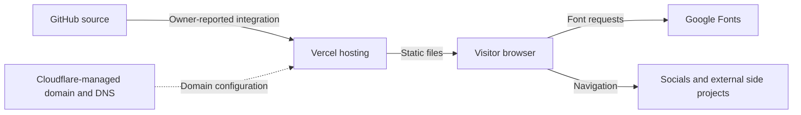

# Technical design and repository review

**Updated:** 2026-10-13. **Original review baseline:** `0dea6ca` — Remove dead Family link from Rabbit Hole menu.

## Design boundary

This is a two-page static website. The existing source is authoritative for current behavior; [PRD](prd.md) describes the owner's intended portfolio, and [backlog](backlog.md) tracks differences. The documentation task changes no website runtime files.

## Source baseline

The original review and its checks below used `0dea6ca68ff20ded291c1fb52d3bb666c4f0e208`. The documentation PR is based on `1121b6252a738794aa2dc7eacd536bbbe852129a` — Remove GenMedia AI link from Rabbit Hole menu. Comparing these commits shows only the removal of that link from `index.html`; the other source files and image assets are unchanged. The current Rabbit Hole therefore links to Self Hosted AI and Non-Profits. GenMedia's future inclusion remains an open product decision, not a currently available navigation destination. No original simulated interaction check was rerun for this documentation publication, and no browser or production verification is implied.

## Current architecture

The diagram records the reported hosting arrangement, not inspected account settings. Cloudflare proxy mode, DNS record values, Vercel's production branch and preview settings are unverified. Cloudflare management does not establish that website traffic is proxied through Cloudflare.

| Component | Contract |
| --- | --- |
| [index.html](../index.html) | Homepage structure, copy, timeline, SVG identity, links and image references |
| [styles.css](../styles.css) | Homepage layout, palette, photo treatment and dropdown visibility |
| [main.js](../main.js) | Dropdown click state, outside-click closing, Escape and focus return |
| [nonprofits.html](../nonprofits.html) | Standalone deck with inline CSS and JavaScript; no dependency on homepage styles or script |
| `images/` | Five JPEG assets referenced by the homepage |

There is no package manifest, compilation, server-side code, database, API integration, form submission, browser storage or analytics code in the reviewed source. The external AI links are navigation destinations, not embedded AI capabilities.

## Homepage behavior

The homepage uses Cormorant Garamond and Jost from Google Fonts, with serif and sans-serif fallbacks. Its palette is defined by CSS variables: background `#0c0a08`, panel `#14110d`, cream `#ece3d6`, muted `#9a9186` and gold `#b99a6a`. These values, the existing tagline and the inline M mark are the retained identity baseline.

The layout has a header, hero, four-photo gallery, employment timeline and copyright. The desktop social rail becomes a footer at widths of 980 px and below. Additional breakpoints at 560, 1360 and 1600 px adjust typography, timeline position and rail placement. These are source observations, not proof of successful device layouts.

At the original review baseline, the Rabbit Hole dropdown linked to Self Hosted AI, GenMedia AI and the local deck, each in a new tab with `rel="noopener"`; the newer base removes GenMedia as noted above. JavaScript changes `.open` and `aria-expanded`; CSS can also reveal the menu through hover. INFO targets the employment block. “Enter the Rabbit Hole” targets the section containing that same link. The four photos are noninteractive, so this section currently provides no selected-work discovery path.

## Non-Profits presentation

The retained presentation is a sample generated by the owner's local AI stack. Seven slides cover AI use in research-focused nonprofits. A page-local index selects the active slide; Previous and Next controls are disabled at the respective bounds. Arrow-key handlers and horizontal swipe detection also change slides.

The deck swaps its comparison table for stacked cards at 768 px and below. It fixes the page to the viewport and uses nested scrolling inside slides. Its viewport settings and touch handler attempt to restrict zoom. Without JavaScript, the initially active title slide remains visible but the deck does not advance.

Sample content includes quantified productivity claims and broad deployment/privacy claims without citations. This review did not validate those claims. Presenting the deck as an AI output sample must not imply that its claims are independently verified or that this portfolio operates the described systems.

## Review findings and verification

Reviewed all four source files, asset sizes, tracked inventory and Git history. JavaScript syntax and selected interactions were checked with Node and a small in-memory DOM simulation. This is source review, not browser automation.

| Finding | Evidence and implication | Work |
| --- | --- | --- |
| R01 — Large image payload | Five JPEGs total **15,751,376 bytes / 15.02 MiB**, with each about 2.8–3.6 MB. No lazy-loading or responsive image sources are declared. This is an asset-size observation; load time was not measured. | B04 |
| R02 — Essential text has low contrast | Experience and copyright use cream at 22% opacity on the dark background, approximately **1.74:1** after alpha compositing. Experience brightens only on hover. Normal text's 4.5:1 reference target comes from [W3C contrast guidance](https://www.w3.org/WAI/WCAG22/Understanding/contrast-minimum.html). | B02 |
| R03 — Placeholder image alternatives | All five homepage images use `alt="..."`. Meaningful images need actual descriptions; decorative placeholders need an intentional empty alternative. Their final role must follow the content decision. | B02 |
| R04 — Dropdown has two visibility states | CSS hover can reveal the dropdown while `aria-expanded` remains false. Escape only closes `.open`, so a hovering pointer can still keep it visible. `menu`/`menuitem` roles are supplied without the matching menu-widget keyboard behavior. A simpler disclosure navigation is described in the [W3C example](https://www.w3.org/WAI/ARIA/apg/patterns/disclosure/examples/disclosure-navigation/). | B02 |
| R05 — Deck Space shortcut is broken | The handler compares `e.key` with `'Space'`. An actual Space key returns `' '`, as documented by [MDN](https://developer.mozilla.org/en-US/docs/Web/API/KeyboardEvent/key). The simulated actual key did not advance the deck. | B03 |
| R06 — Deck reading and motion need review | `user-scalable=no`, `maximum-scale=1.0` and double-tap suppression attempt to restrict zoom; browser behavior varies. See [MDN viewport guidance](https://developer.mozilla.org/en-US/docs/Web/HTML/Reference/Elements/meta/name/viewport). Swipe logic considers horizontal distance only. Neither page has reduced-motion styling. Actual zoom, vertical-scroll interactions and small-screen layout need browser/device checks. | B02, B03 |
| R07 — Portfolio evidence is sparse | No project summaries, outcomes or repository/demo cards exist. Netflix is named but the accepted people-leadership emphasis is absent. The presentation link is not contextualized as an AI sample. | B01 |
| R08 — Deployment settings are external | No Vercel configuration or CI workflow is tracked. This does not mean deployment automation is absent; account settings must establish the actual release path. | B05 |

Neither page includes description or social-preview metadata. This is an optional presentation improvement within B01, not an accepted SEO programme.

| Check performed | Result and limit |
| --- | --- |
| `node --check main.js` | Passed syntax only |
| Compile inline deck script with Node's `vm.Script` | Passed syntax only |
| Homepage local `src`/`href` targets | All referenced local files exist |
| Dropdown click, outside click and Escape | Passed in the simulated DOM; CSS hover and real focus behavior not exercised |
| Deck initial state, arrow advancement and repeated boundary navigation | Passed in the simulated DOM |
| Deck Space event with `key: ' '` | Reproduced failure to advance |
| CSS contrast calculation | Approximately 1.74:1 for the specified default text/background pair; no full-page accessibility audit |
| Live site | Web research tool could not retrieve the public URL; no uptime conclusion |

No fixes, performance measurements, external-link health checks, real-device checks, Vercel account inspection or production release were performed by this review.

## Future design implications

The overhaul should improve the professional narrative and selected-work presentation while retaining the brand elements in FR-07 and social access in FR-03. It should keep the employment timeline and frame the deck as sample work. The ecommerce project has no published destination yet.

The current static implementation can support those outcomes. Retaining it is a review recommendation, not an invented owner decision about future frameworks. Any technology change should explain what concrete portfolio requirement needs it. No framework migration is part of this documentation task.

Keep project content curated in source unless an actual editing requirement justifies another system. An unpublished project can have an honest descriptive entry without a dead demo button. Detailed project copy, visual layout, GenMedia's disposition and replacement imagery remain open in the PRD.
